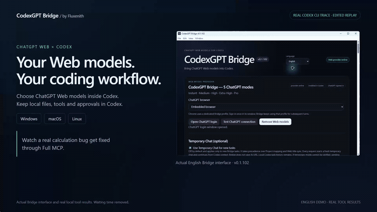

# CodexGPT Bridge

**Use ChatGPT Web models available to your account inside Codex.**

[English](README.md) · [繁體中文](README.zh-TW.md) · [简体中文](README.zh-CN.md) · [日本語](README.ja.md) · [한국어](README.ko.md)

**[Download for Windows, macOS or Linux](https://github.com/Fluxenith/codexgpt-bridge/releases/latest)** ·
**[Quick start](#get-started)** ·
**[Early-tester feedback](https://github.com/Fluxenith/codexgpt-bridge/issues/new?template=early_tester_feedback.md)**

CodexGPT Bridge connects your signed-in ChatGPT Web session to Codex. Choose
available Web models inside Codex while Codex handles project files, tools and
approvals. Bridge supports separate task conversations, images, progress
updates and cancellation.

This is an independent third-party project, unaffiliated with OpenAI.

**v0.1.103:** Full MCP can download and verify its official Tunnel client
automatically. Leave the client path blank; Tunnel credentials and plugin
permissions are still required.

## See Bridge in action



46-second English demo · [Full-resolution MP4](assets/launch/demo-en.mp4)

A real Codex CLI run using Bridge's Medium model and Full MCP fixes a small
calculation bug. The same tests go from **1 pass / 2 failures** to
**3 passes / 0 failures**, with test assertions unchanged. This is an edited
replay of actual tool events and output, with an actual English Bridge screenshot.
It does not demonstrate first-time installation. The trace and interface were
recorded with v0.1.102; the automatic client setup described below is available
in v0.1.103. Created by [Fluxenith](https://github.com/Fluxenith).

## Choose a connection mode

|                  | Simple                                    | Full MCP                                                       |
| ---------------- | ----------------------------------------- | -------------------------------------------------------------- |
| Best for         | Trying model responses with minimal setup | ChatGPT models calling Codex tools                             |
| Tool integration | Tool instructions are passed as text      | Tool calls use a custom ChatGPT plugin and Secure MCP Tunnel   |
| Extra setup      | No custom plugin or Tunnel                | Plugin access, Tunnel permissions and compatible tunnel-client |

Start with **Simple** to try Bridge. Choose **Full MCP** when you need
actual tool calls and your account and workspace support the required connector.
See **[ChatGPT plugin setup](#chatgpt-plugin-setup)** or the
**[繁體中文設定教學](README.zh-TW.md#chatgpt-外掛設定)**.

## Install

Download the installer for your operating system from this repository's
**[Releases](https://github.com/Fluxenith/codexgpt-bridge/releases/latest)** page. Windows uses the `CodexGPT-Bridge-Setup-<version>.exe` installer;
macOS uses a DMG and Linux uses an AppImage or DEB.

**macOS testing builds:** Intel and Apple Silicon downloads are not Apple-notarized.
After opening the app once, macOS may require **System Settings → Privacy &
Security → Open Anyway**. Only allow the app if you trust its source. See
[Apple’s instructions](https://support.apple.com/en-us/102445).

You need Codex and a ChatGPT account with access to the models you want to use.
Available models and usage limits depend on your account.
Bridge automates a signed-in ChatGPT Web session and depends on an interface
that may change. OpenAI's [Terms of Use](https://openai.com/policies/terms-of-use/)
prohibit automatic or programmatic extraction of data or Output and
circumventing rate limits. This integration may conflict with applicable terms;
confirm that your use is authorized before trying it. Bridge cannot guarantee
account safety, continuous access, or additional usage allowance.

## Get started

1. Open Bridge and choose your browser and tool connection. Simple mode is the
   quickest way to start; Full MCP requires its connector and tunnel setup.
2. Choose **Open ChatGPT login** and sign in. For Chrome, return to Bridge and
   choose **Sign-in complete, continue** when finished.
3. Choose **Test ChatGPT connection**, then **Install Web models**.
4. Restart Codex and select a `CodexGPT Bridge — …` model.

Keep Bridge running while using its models. Closing the window leaves it in the
system tray; **Quit** stops it. **Remove Web models** restores the settings
previously managed by Bridge.

The interface supports English, Traditional Chinese, Simplified Chinese,
Japanese and Korean. Use the **Language** menu to switch.

Available models and effective context limits depend on the installed Bridge
version and your account. The demo above verifies a small code-editing task;
it does not establish a maximum context size.

## ChatGPT plugin setup

Full MCP uses a custom ChatGPT MCP plugin, also called an App or connector in
some interfaces, to call the current Codex task's tools. Simple mode passes
tool instructions as text and does not require a plugin or Tunnel.

Set up in this order: **get a Tunnel → configure Bridge → start Web models →
create and install the ChatGPT plugin → verify from Codex**.
The [Traditional Chinese guide](README.zh-TW.md#chatgpt-外掛設定) includes a full
field-by-field walkthrough and troubleshooting table.

### 1. Get access and Tunnel credentials

Follow the official [Secure MCP Tunnel guide](https://developers.openai.com/api/docs/guides/secure-mcp-tunnels).
You need access to custom MCP plugins in the target ChatGPT account/workspace
and separate Tunnel permissions in the target Platform organization:
**Read + Manage** to create/edit a Tunnel and **Read + Use** to run the client
or select the Tunnel in ChatGPT. Ask the appropriate administrator for access
if needed; use Simple while these capabilities are unavailable.

Check your account and the [official custom MCP guide](https://developers.openai.com/api/docs/guides/custom-mcp-server)
for availability and navigation. A Pro subscription alone does not establish
Tunnel or workspace permissions.

1. Open [Platform Tunnel settings](https://platform.openai.com/settings/organization/tunnels)
   in the intended organization, then create or select a Tunnel.
2. Associate it with the target ChatGPT workspace and the Platform organization.
   An organization-only association does not automatically expose it to another workspace.
3. Copy the Tunnel ID (`tunnel_` followed by 32 lowercase hexadecimal characters)
   and ask your Platform organization administrator for a runtime API key for
   `tunnel-client` with the required access.
4. Leave the **tunnel-client path** blank. On first Full MCP use, Bridge downloads
   the pinned official client for your OS/architecture, verifies its SHA-256
   checksum, and installs its companion files automatically. Later starts reuse
   the verified local installation. The first setup needs internet access.
   To use your own installation, enter its absolute executable path as an
   advanced override; it must support `tunnel-client runtimes connect --help`.

### 2. Configure Bridge and start the service

Sign in through Bridge and test the ChatGPT connection. Under **Codex tool
connection**, select **Full MCP — connector tool calls** and expand
**Advanced Tunnel settings**.

| Field                  | Value                                                                                 |
| ---------------------- | ------------------------------------------------------------------------------------- |
| ChatGPT connector name | For example, `CodexGPT Bridge`; must exactly match the plugin name, including spaces  |
| OpenAI Tunnel ID       | The complete Tunnel ID from Platform                                                  |
| OpenAI API key         | The runtime API key for tunnel-client; an already saved key need not be entered again |
| tunnel-client path     | Leave blank for automatic download and verification; optional absolute path override  |

Choose **Apply**, then **Install Web models**. Keep Bridge running and wait for
**Tunnel: ready** before creating the ChatGPT plugin. Bridge starts and manages
the client and its local MCP endpoint; do not start a second client for the same
Tunnel alongside it.

**Apply alone does not start a Web model service that has not been installed.**
When the service is already running, Apply restarts its connection. If the first
installation fails, resolve the reported client, credential or permission error.

### 3. Create and install the ChatGPT plugin

Follow [Add custom MCP server](https://developers.openai.com/api/docs/guides/custom-mcp-server)
using the same ChatGPT account/workspace that Bridge uses:

1. Enable **Developer mode** under **Settings → Security and login**, as described
   in the [official Tunnel connection example](https://developers.openai.com/cookbook/examples/partners/aws/chatgpt_agents_sdk_aws_agentcore_cookbook/notebooks/chatgpt_agents_sdk_aws_agentcore_cookbook#7-test-the-plugin-connection-in-chatgpt-through-secure-mcp-tunnel).
   Then open [ChatGPT Plugins](https://chatgpt.com/plugins), select **+**, and
   **Add custom MCP server**. If the switch or page is unavailable, check workspace policy and account access.
2. Enter the exact connector name configured in Bridge.
3. Under **Connection**, select **Tunnel** and choose or paste the same Tunnel ID.
   You do not need to enter Bridge's local loopback address as a Server URL.
4. Select **No authentication** for Bridge's built-in MCP server, which does not
   implement an OAuth login. The runtime API key belongs in Bridge's Tunnel
   settings, not in ChatGPT's OAuth Client Secret field.
5. Review the permission warning, select **I understand and want to continue**,
   then **Create as a plugin**.
6. Find the plugin in your personal plugins or target workspace and **install/enable**
   it. Ensure its required tools are enabled.

If your account still shows the older Apps/connectors interface, follow its
Developer Mode and custom App creation/enablement controls with the same name
and Tunnel ID. Missing creation controls require checking account/workspace access.

### 4. Verify a real tool call

Restart Codex, select a `CodexGPT Bridge — …` model, and start a new task in a
test project. Ask it to list the project root's file names without modifying
files. Confirm an actual Codex tool call and its result; a text claim that the
connection works is insufficient.

You can also type `@` in ChatGPT to check whether the installed plugin is
available. Bridge tools require an active Codex task context, so invoking them
from an unrelated chat may report that there is no active task.

For the first test, use ordinary chats and automatic submission. Apply Full MCP
before selecting manual submission. Temporary chats must allow Apps.

### Troubleshooting setup

| Symptom                              | Action                                                                                                                                                               |
| ------------------------------------ | -------------------------------------------------------------------------------------------------------------------------------------------------------------------- |
| Tunnel is not ready after Apply      | Install Web models to start the service and keep Bridge running                                                                                                      |
| Client path or command error         | Clear the client path for automatic setup; an optional override must be an existing compatible executable                                                            |
| Automatic download or checksum error | Check access to official GitHub downloads and retry; unverified downloads are never executed. An existing official installation can be selected in advanced settings |
| Credential or Tunnel access error    | Check key validity, ID, organization and Tunnels Read + Use; apply again after replacing the key                                                                     |
| Tunnels access required              | Ask the Platform organization administrator for organization-level access; new role assignments can take up to 30 minutes                                            |
| Tunnel missing in ChatGPT            | Check the target workspace association and the creator's Read + Use permissions                                                                                      |
| Plugin cannot discover tools         | Wait for Tunnel: ready, then retry creation or refresh plugin tools                                                                                                  |
| Tunnel ready but tools unavailable   | Check plugin installation, tool enablement, exact name and matching account/workspace; retry in a new Codex task                                                     |
| Connection stops                     | Keep Bridge running, confirm Web models are installed, run Doctor and check outbound HTTPS connectivity to OpenAI                                                    |

Keep runtime API keys and personal settings out of documentation, issues and screenshots.

## Updates and troubleshooting

The GitHub release workflow bundles this repository's update feed into installers,
so users do not need to enter an update URL.
Bridge checks for new versions at startup and in the background. Updates require
an accessible release feed and installer; until that feed is available, download
new versions from **[Releases](https://github.com/Fluxenith/codexgpt-bridge/releases/latest)**.

If the connection fails, check your ChatGPT login and use Bridge's **Doctor**
diagnostics. Include your app version, operating system and steps to reproduce
when reporting a problem. Remove account details, private paths, conversation
contents and credentials from reports.

Login data and settings remain in the application's local user profile.

## Help test Bridge

Bridge is an early project. If you try it, please
**[share early-tester feedback](https://github.com/Fluxenith/codexgpt-bridge/issues/new?template=early_tester_feedback.md)**:
your operating system, connection mode, whether setup succeeded, and whether
a small Codex task worked. Please omit credentials, cookies, private code,
personal conversation content and identifying account information.

## Build from source

Use Node.js 22.20.0 or newer and pnpm 11.19.0:

```powershell
pnpm install --frozen-lockfile
pnpm desktop
```

## Third-party notices

Dependency licenses are included in [THIRD_PARTY_NOTICES.txt](THIRD_PARTY_NOTICES.txt)
and `LICENSES/`. This project is licensed under the [MIT License](LICENSE).
